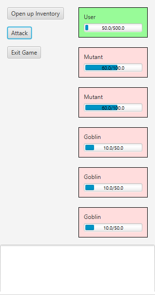
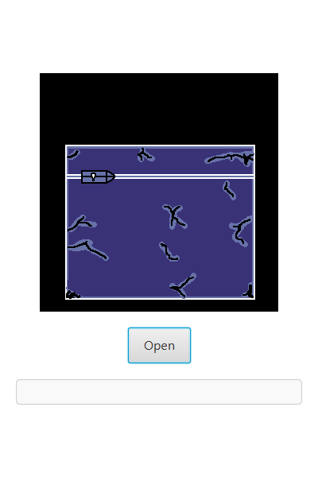
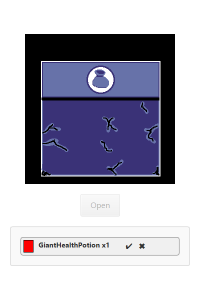
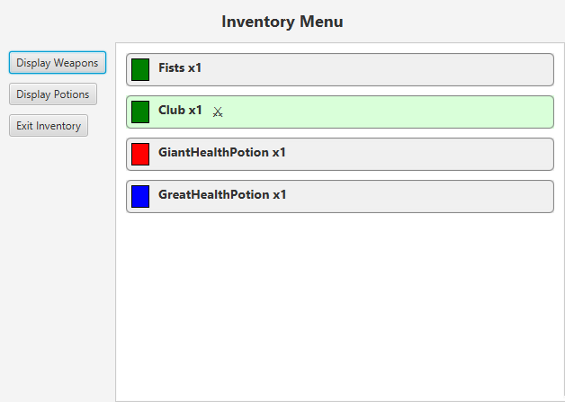
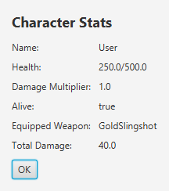
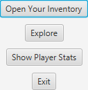
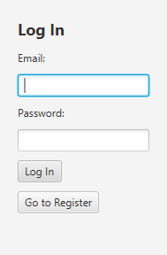
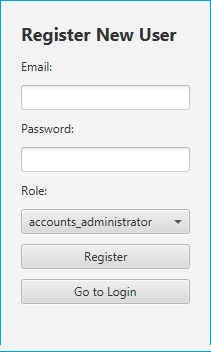
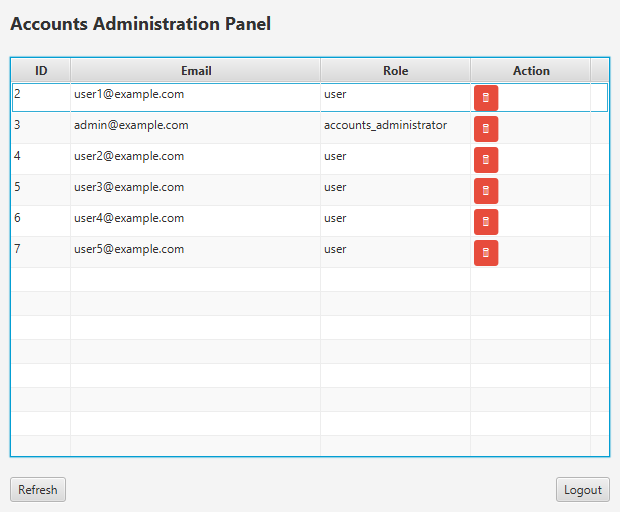

# Simple RPG Game

A turn-based role-playing game built with **Java 21** and **JavaFX**. Progress is saved per account in a **MySQL** database. You log in, create a character, and work through a run of battles and treasure chests while managing an inventory with weight and slot limits.

I built it as a university project. It started as a terminal game and was later rewritten with a JavaFX interface, a database layer and user accounts with roles.

---

## Screenshots

### Gameplay

<table>
  <tr>
    <th>Battle</th>
    <th>Treasure chest</th>
    <th>Chest opened</th>
  </tr>
  <tr>
    <td></td>
    <td></td>
    <td></td>
  </tr>
</table>

<table>
  <tr>
    <th>Inventory</th>
    <th>Character stats</th>
    <th>Main menu</th>
  </tr>
  <tr>
    <td></td>
    <td></td>
    <td></td>
  </tr>
</table>

### Accounts

<table>
  <tr>
    <th>Login</th>
    <th>Registration</th>
    <th>Accounts administration panel</th>
  </tr>
  <tr>
    <td></td>
    <td></td>
    <td></td>
  </tr>
</table>

---

## Features

- **Accounts and roles.** Players can register and log in. Email and password rules are checked with regular expressions. Each account has a role:
  - `user` plays the game.
  - `accounts_administrator` gets an admin screen that lists all accounts and can delete them.
- **Saved progress.** The character, the inventory and how far you've got through the run are stored in MySQL. Logging back in continues the same game.
- **Exploration run.** A run is a fixed sequence of 8 stages, each either a battle or a loot chest. Win the last stage to finish the game.
- **Turn-based combat.** You fight groups of enemies (Bats, Golden Bats, Goblins, Mutants), and each enemy has its own health bar. Each turn your attack hits every enemy, then every surviving enemy hits back.
- **Loot and rarity.** Chests drop a random weapon or potion. The item's quality tier is rolled with weighted chances (50% / 30% / 15% / 5%), then a random item of that tier is picked from a CSV loot table.
- **Inventory.** Identical items stack, and there are limits on total weight and number of slots. You can filter by weapons or potions, click a weapon to equip it, or click a potion to drink it.
- **Items.** 8 weapons, from Fists to the Holy Sword, and 5 potions, including healing potions and a risky Death Potion.
- **Cheat mode.** Start the program with the argument `cheatMode` to play a character with very high stats.

## Tech Stack

| Area | Technology |
|---|---|
| Language | Java 21 (JPMS module) |
| UI | JavaFX 21, FXML |
| Database | MySQL 8, JDBC (`PreparedStatement`) |
| Build | Maven (wrapper included) |
| Testing | JUnit 5 |

## Architecture

```
src/main/java/com/example/PIIIProjectGUI/
├── Main.java, GameState.java     # Entry point and shared game state
├── controllers/                  # JavaFX controllers, one per screen (FXML)
├── database/                     # DAO layer: AccountsDAO, CharacterDAO, InventoryDAO
├── implementation/
│   ├── interfaces/               # Item, LivingEntity, BattleInterface, LootableAreaInterface
│   └── classes/
│       ├── player/               # Character
│       ├── livingEntities/       # Enemy hierarchy
│       ├── items/                # Weapon and Potion hierarchies
│       ├── encounters/           # Battles and loot chests
│       └── gameState/            # Explore (run progression), Inventory
├── utilities/                    # ViewNavigator (window/scene stack), reflection factory, helpers
├── inputoutput/                  # CSV reading/writing, console output
└── exceptions/                   # Custom exceptions
src/main/resources/.../views/     # FXML screens
MySQLscripts/TableInitializer.sql # Database schema
```

Design points:

- **Object-oriented model.** Interfaces and abstract classes (`Item`, `Weapon`, `Potion`, `Enemy`, `LootableArea`) let new items, enemies and encounters be added without changing the game loop. Items implement `Comparable` so they can be sorted.
- **DAO pattern.** All SQL is kept in the `database` package and uses parameterised queries, which prevents SQL injection.
- **Data-driven loot.** The item pools are read from CSV files, and item classes are created by name using reflection.
- **Window navigation.** `ViewNavigator` keeps a stack of open windows, so screens can be switched in place, opened as pop-ups (such as the inventory during a battle) or all closed at once.

## Database Schema

Three tables, linked by foreign keys with cascading deletes:

- `accounts`: email, password, role, and a `new_game` flag
- `characters`: stats, equipped weapon, and run progress, linked to an account
- `inventory`: item name, type and quantity, linked to a character

## Getting Started

### Prerequisites
- JDK 21
- MySQL 8 server running locally

### 1. Create the database
```bash
mysql -u root -p < MySQLscripts/TableInitializer.sql
```

### 2. Configure the connection
Credentials are read from environment variables, not from the source code:

| Variable | Default |
|---|---|
| `GAME_DB_URL` | `jdbc:mysql://localhost:3306/game_db` |
| `GAME_DB_USER` | `root` |
| `GAME_DB_PASSWORD` | *(empty)* |

```powershell
# Windows (PowerShell)
$env:GAME_DB_PASSWORD = "your_password"
```
```bash
# macOS / Linux
export GAME_DB_PASSWORD="your_password"
```

### 3. Run
```bash
./mvnw clean javafx:run        # macOS / Linux
mvnw.cmd clean javafx:run      # Windows
```

### Run the tests
```bash
./mvnw test
```

## Possible Improvements

Things I would change in a next version:

- Hash passwords (for example with BCrypt) instead of storing them as plain text, and stop letting users pick the admin role when they register
- Save inventory changes in a single database transaction, and add unique constraints to the schema
- Separate the game logic from the JavaFX UI code, and replace the shared static state with dependency injection
- Move the CSV loot tables into `resources` so the game can be packaged as a standalone app
- Add more unit tests, especially for the inventory logic
